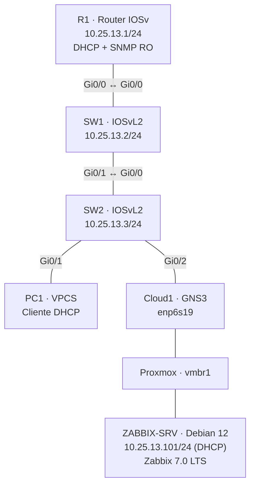

<div align="center">

# 🛰️ ITLA | Network Monitoring with Zabbix & SNMP

### Monitoreo de infraestructura Cisco virtualizada con GNS3, Proxmox VE y Zabbix 7.0 LTS

**Cisco IOSv · IOSvL2 · SNMPv2c · DHCP · Debian 12 · MariaDB · Nginx**


</div>

---

## 📖 Descripción

Laboratorio académico de **monitoreo de red** que integra equipos Cisco virtuales desplegados en **GNS3**, un servidor **Zabbix 7.0 LTS** alojado en un contenedor Debian 12 sobre **Proxmox VE**, y recopilación de métricas mediante **SNMPv2c**.

El proyecto demuestra configuración de direccionamiento IPv4, DHCP para clientes, administración de dispositivos por SNMP de solo lectura, visualización de tráfico y disponibilidad, y detección y recuperación de incidentes de conectividad.

> **Alcance:** laboratorio aislado, con direcciones privadas y configuraciones de ejemplo. No está diseñado para exposición directa a Internet.

## 🎯 Objetivos

- Implementar una LAN funcional con un router, dos switches y un cliente DHCP.
- Configurar direccionamiento IPv4 y servicio DHCP en Cisco IOSv.
- Habilitar SNMP de **solo lectura** en los tres dispositivos.
- Instalar Zabbix Server y sus servicios dependientes.
- Agregar dispositivos mediante la plantilla `Cisco IOS by SNMP`.
- Monitorear tráfico, interfaces, disponibilidad y métricas compatibles con cada imagen.
- Validar la generación y recuperación de alertas ante una interrupción controlada.

## 🧰 Tecnologías

| Componente | Tecnología | Función |
|---|---|---|
| Hipervisor | Proxmox VE 8.4 | Alojamiento del laboratorio |
| Emulador de redes | GNS3 | Topología y dispositivos virtuales |
| Router | Cisco IOSv 15.9 | Enrutamiento, DHCP y SNMP |
| Switches | Cisco IOSvL2 15.2 | Conmutación de capa 2 y SNMP |
| Servidor de monitoreo | Zabbix 7.0 LTS | Recolección, métricas y alertas |
| Sistema operativo | Debian 12 (LXC) | Servidor Zabbix |
| Base de datos | MariaDB 10.11 | Persistencia de Zabbix |
| Interfaz web | Nginx + PHP-FPM | Dashboard y administración |
| Protocolos | IPv4, DHCP, ICMP, SNMPv2c | Operación y monitoreo |

## 🗺️ Arquitectura



La conexión a Cloud1 enlaza el dominio de capa 2 de GNS3 con el contenedor de monitoreo mediante `vmbr1`. El contenedor dispone además de una interfaz independiente para acceso web en la LAN doméstica, empleada durante la instalación.

### Direccionamiento

| Equipo | Dirección | Asignación |
|---|---|---|
| R1 | `10.25.13.1/24` | Estática |
| SW1 (VLAN 1) | `10.25.13.2/24` | Estática |
| SW2 (VLAN 1) | `10.25.13.3/24` | Estática |
| PC1 | `10.25.13.100/24` | DHCP (observada en pruebas) |
| ZABBIX-SRV (eth0) | `10.25.13.101/24` | DHCP (observada en pruebas) |
| Red del laboratorio | `10.25.13.0/24` | Privada |

**DHCP en R1:** pool `LAN-ZABBIX`; rango utilizable mediante exclusiones: `10.25.13.100–10.25.13.199`; gateway `10.25.13.1`; DNS `1.1.1.1` y `8.8.8.8`; concesión de 7 días.

## 📊 Monitoreo implementado

El tablero **ITLA | Network Infrastructure & SNMP Monitoring** incluye:

- Disponibilidad SNMP de **R1, SW1 y SW2**.
- Gráficos de tráfico recibido y enviado en `Gi0/0` de los tres equipos.
- Utilización de CPU de R1 mediante una métrica disponible.
- Estado operativo `up (1)` / `down (2)` de `Gi0/0` de SW1 y SW2.
- Widget de problemas e historial reciente de alertas.

> Las imágenes IOSvL2 no expusieron la rama `CISCO-PROCESS-MIB` consultada para CPU. Se muestran estados reales de interfaces en lugar de inventar porcentajes de CPU.

## 🧪 Validaciones realizadas

| Prueba | Resultado observado |
|---|---|
| DHCP a PC1 | Dirección `10.25.13.100` asignada |
| Conectividad en la LAN | Ping entre dispositivos verificado |
| Consultas SNMPv2c | R1, SW1 y SW2 responden al OID `sysName.0` |
| Disponibilidad | 3/3 equipos disponibles en operación normal |
| Gráficos de tráfico | Métricas RX/TX visibles en Zabbix |
| Incidente simulado | `shutdown` temporal en `Gi0/0` de SW2 |
| Detección | Alertas ICMP de indisponibilidad en R1 y SW1; evento de interfaz en SW2 |
| Recuperación | `no shutdown`, 3/3 dispositivos disponibles y eventos recuperados |

**Nota técnica:** apagar el enlace SW1–SW2 interrumpió el acceso de Zabbix a R1 y SW1; SW2 siguió accesible desde Cloud1. Esta dependencia explica las alertas de conectividad observadas.

## 🛠️ Troubleshooting destacado

Durante las primeras pruebas, las solicitudes SNMP salían de `ZABBIX-SRV` pero no recibían respuesta. La inspección de capturas evidenció **checksums UDP incorrectos** en paquetes transmitidos a los dispositivos emulados. Deshabilitar el **TX checksum offloading** de la interfaz del contenedor resolvió el problema.

```bash
ethtool -K eth0 tx off
```

La corrección se configuró de forma persistente mediante un servicio `systemd` de tipo `oneshot`. Consulta [Troubleshooting](docs/troubleshooting.md) para diagnóstico y verificaciones.

## 📂 Organización

```text
.
├── README.md
├── docs/
│   ├── arquitectura.md
│   ├── monitoreo-zabbix.md
│   └── troubleshooting.md
├── configs/         # Exportaciones Cisco saneadas (pendientes)
├── evidencias/      # Capturas de GNS3, DHCP, SNMP y alertas (pendientes)
└── video/           # Enlace de demostración (pendiente)
```

Las carpetas de evidencia y configuración se incorporarán cuando sus archivos hayan sido revisados y anonimizados.

## 🔐 Seguridad

- SNMPv2c utiliza comunidades transmitidas en texto claro: **solo para laboratorio aislado**.
- En GitHub se publicarán configuraciones **sanitizadas**, nunca comunidades SNMP reales, credenciales, secretos ni capturas que los revelen.
- No se publicarán imágenes propietarias de Cisco ni discos de máquinas virtuales.
- Para entornos productivos se recomienda **SNMPv3**, segmentación de administración y cifrado de la interfaz web.

## 📚 Documentación

- [Arquitectura y direccionamiento](docs/arquitectura.md)
- [Instalación y monitoreo Zabbix](docs/monitoreo-zabbix.md)
- [Solución de problemas SNMP](docs/troubleshooting.md)

## 👨‍💻 Autor

**Elian Sterling Severino Mejía**  
Instituto Tecnológico de Las Américas (ITLA) · Seguridad Informática  
Matrícula: **2025-1331**

---

<div align="center"><sub>Proyecto académico de infraestructura, monitoreo de redes y respuesta a incidentes.</sub></div>
