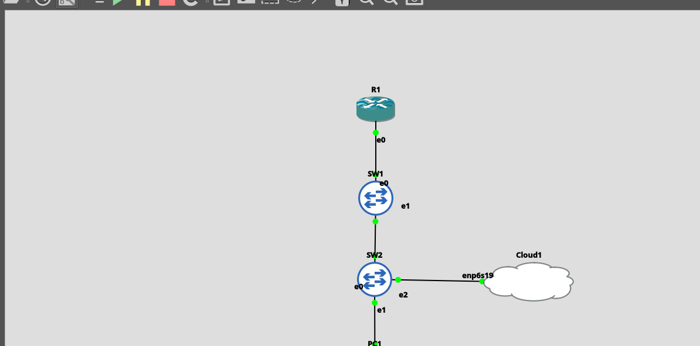
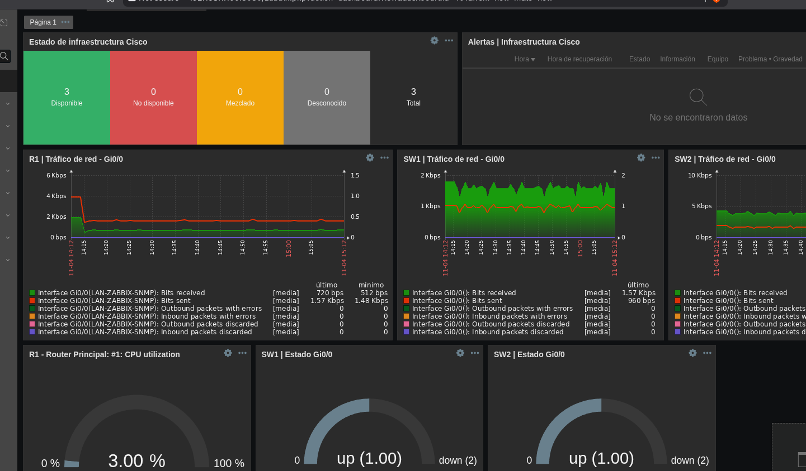
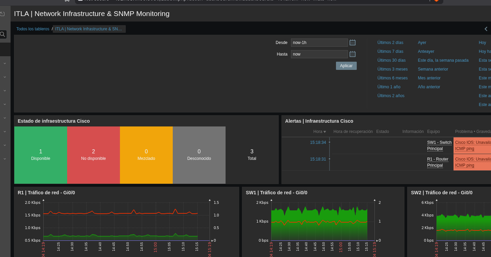
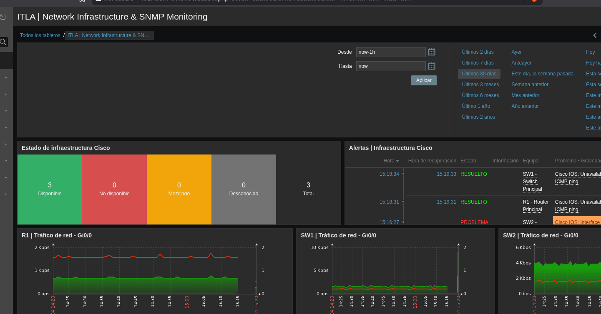
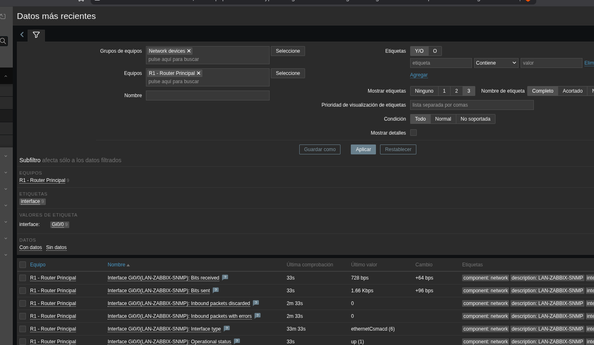
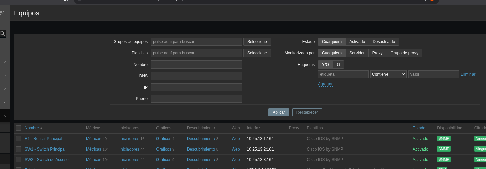

# 📸 Evidencias del laboratorio

Las capturas provienen de las pruebas realizadas en el laboratorio GNS3 + Zabbix 7.0 LTS. Se han recortado para centrar la evidencia en el contenido técnico, sin mostrar las ventanas de chat.

## 01 — Topología física/lógica GNS3

La topología muestra **R1 → SW1 → SW2**, el cliente **PC1** y el enlace de **Cloud1** hacia el segmento utilizado por Zabbix. Los puntos verdes indican nodos activos en GNS3.

## 02 — Dashboard Zabbix

El dashboard integra estado SNMP de los tres dispositivos, gráficos de tráfico Gi0/0, CPU de R1, estado operativo de interfaces y un widget de alertas.

## 03 — Incidencia detectada

Prueba controlada con `shutdown` temporal en Gi0/0 de SW2: las consultas a R1 y SW1 dejan de responder, y Zabbix genera eventos de indisponibilidad ICMP.

## 04 — Recuperación de incidentes

Tras ejecutar `no shutdown`, se restaura la conectividad. Se observan eventos recuperados y tres equipos disponibles. La captura aún incluye un evento de interfaz antes de su posterior recuperación confirmada.

## 05 — Métricas SNMP de R1

Se observan métricas de tráfico entrante/saliente, estado de enlace y errores/descartes para la interfaz `Gi0/0` de R1.

## 06 — Inventario y disponibilidad SNMP

Los equipos `R1`, `SW1` y `SW2` aparecen configurados en Zabbix con indicadores SNMP disponibles.

---

## Seguridad y publicación

No se han incorporado archivos PCAP: **SNMPv2c transmite las comunidades en texto claro**. Se recomienda revisar cualquier captura o configuración adicional y eliminar credenciales, tokens y comunidades antes de publicarla.

[Volver al README principal](../README.md)
